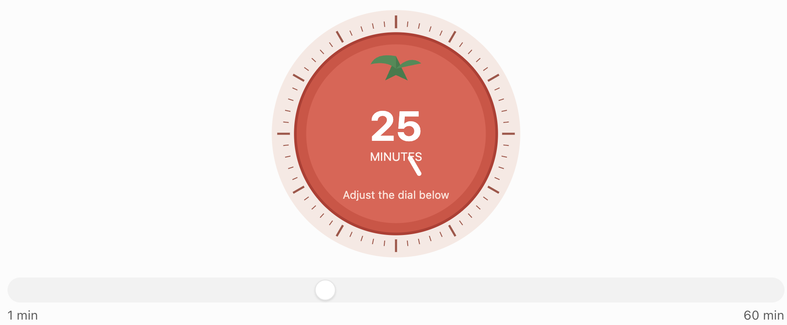

# Study Reviewer Feature Specifications

This document describes the intended initial behavior. It is a product
specification, not an implementation or a claim that these features currently
exist.

## Shared conventions

- The content hierarchy is `Category → Topic → Question & Answer or Term & Definition`.
- Names are required for categories and topics; descriptions are optional.
- Questions/terms and answers/explanations are required entry fields.
- IDs are stable and generated locally. Display ordering is derived from
  explicit sort choices and timestamps.
- Destructive actions require a confirmation that names the affected content.
- Empty states explain what is missing and provide the next relevant action.
- Storage, import, and export errors are visible and must not silently discard
  the user's current data.

## Application shell and navigation

The app shell provides access to Dashboard, Categories, and Settings, with
breadcrumbs on category and topic detail views. Topic breadcrumbs link through
Home, Categories, and the parent category before identifying the current topic.
The active location is visible to keyboard and screen-reader users. A
context-aware floating Add button is
available while scrolling and opens the appropriate creation form for the
current page. It must not overlap the persistent Pomodoro widget or obscure
content on mobile. On small screens, the primary navigation opens in a
full-screen sliding panel with an explicit close control and active-page state.

## Dashboard

### Overview statistics

Display these values using the current local data:

- Total categories
- Total topics
- Total question-and-answer entries
- Total completed Pomodoro Focus sessions
- Total recorded completed focus time

Counts should update after successful CRUD operations, imports, and completed
Focus sessions. They should not count deleted content or abandoned timer
sessions.

### Recently accessed items

Show recently opened or studied categories and topics, ordered by most recent
activity. Each item links directly to its destination. The empty state should
explain that recently accessed items will appear after the user opens a
category or topic and should link to Categories.

There is no separate Quick Actions section. Creation is handled by the
context-aware Add button.

## Categories

The Categories page supports:

- Search by category name, case-insensitively
- Sorting alphabetically or by recent activity
- Cards showing category name, optional description, topic count, and entry
  count where useful
- Create, rename, open, and delete actions

Deleting a category shows the number of topics and entries that will also be
deleted. Confirming performs one cascade operation; cancelling leaves all data
unchanged. Opening a card navigates to Category Detail / Topics.

If no categories exist, show a concise explanation and a create-category
action. If search returns no matches, preserve the search term and offer a
clear-search action.

## Category Detail / Topics

The category detail page shows the category name, optional description, topic
count, and a breadcrumb back to Categories. It supports:

- Search topics by name
- Sorting alphabetically or by recent activity
- Topic cards showing topic name and question count
- Create, edit, open, and delete actions

Deleting a topic displays the number of entries that will be removed and
requires confirmation. A category with no topics has an empty state that
explains how to create the first topic. Opening a topic navigates to its
reviewer.

## Topic Detail / Study

The topic view shows the topic name, category breadcrumb, and total question
count. It contains entry management, search/sort controls, and the two study
modes.

### Entry management

- Create an entry as either Question & Answer or Term & Definition.
- Edit the entry type and either field without changing the entry ID.
- Delete an entry after confirmation.
- Search both question and answer text, case-insensitively.
- Sort by newest, oldest, or alphabetical question/term.
- Existing entries migrate safely to Question & Answer when the entry type is absent.

Forms must show required-field errors, preserve entered values when validation
fails, and report storage failures without claiming the change was saved.

### List Mode

List Mode displays each entry in an individual responsive two-column card:

| Column | Content |
| --- | --- |
| Question / Term | Question or term text |
| Answer / Definition | Answer or definition text, visible according to state |

Each card uses `Question` and `Answer` headers for Question & Answer entries or
`Term` and `Definition` headers for Term & Definition entries. Edit and Delete
actions belong to the complete card and are presented in a shared action area.
The action area is visible on touch devices and appears on desktop hover or
keyboard focus.
Visible and hidden entry content use the same plain card surfaces; hidden cells
replace only their text with a clickable Reveal placeholder.

The search and sorting toolbar keeps the left/right visibility controls beside
the sort control on desktop and places them below the search controls on
narrow screens.

Controls behave as follows:

- `Hide Left` / `Reveal Left` toggles Question / Term content in every card
  while keeping the left column visible.
- `Hide Right` / `Reveal Right` toggles Answer / Definition content in every
  card while keeping the right column visible.
- Clicking an individual left or right cell reveals or hides only that cell.
- Hidden cells use an understandable label and remain keyboard operable.

Both columns are visible by default. Individual answers remain independently
revealable, and visibility is presentation state rather than content data.

On narrow screens, the two-column view may stack while preserving the question
and answer relationship. Controls need accessible names and visible state.

### Flashcard Mode

Flashcard Mode shows one question at a time:

- Front: the current question or term
- Back: the corresponding answer or explanation
- Click or tap flips the card
- Previous and Next move through the current ordered set
- Current position is visible, such as `3 of 12`
- Optional Shuffle changes the session order without changing stored entries

Planned entry-type orientation:

- Question & Answer uses Question first by default.
- Term & Definition uses Definition first by default.
- Each entry type has its own configurable front-side preference.
- Mixed flashcard sessions automatically respect each entry's type.
- Preferences are saved locally.
- Keyboard controls support flip, previous, and next actions
- The card and controls expose sensible semantics to assistive technology

Changing search, sort, or shuffle should reset or clearly reconcile the
current position so the user is never shown a stale index. Deleting the current
entry moves to the nearest valid entry or the empty state.

The initial version does not add difficulty, mastered, tag, or advanced-filter
controls.

## Settings

Settings are grouped into clear sections and saved locally.

### Appearance

- Light theme
- Dark theme
- System theme

Theme changes apply without losing unsaved form data. The default is System.

### Study Preferences

- Default study mode: List or Flashcard
- Default question visibility
- Default answer visibility
- Enable or disable copy and paste in relevant study input fields
- Enable or disable browser spellcheck

Copy/paste restrictions apply only to the relevant editable study inputs, not
to the browser, stored data, or study display. The setting should default to
allowing normal editing. When restrictions are enabled, explain that browser
and assistive-technology behavior can vary and that blocking paste may harm
password-manager-like workflows, screen-reader users, or efficient editing.
Do not promise that every browser or operating-system integration can be
overridden.

Spellcheck is delegated to the browser and operating system. The product may
set the relevant input attribute, but it must not claim to provide a custom
offline autocorrect engine.

### Pomodoro Preferences

Defaults:

- Focus: 25 minutes
- Short Break: 5 minutes
- Long Break: 15 minutes
- Focus sessions before a Long Break: 4
- Auto-switch to the next mode: enabled
- Auto-start the next countdown: disabled
- Optional sound and notifications: disabled until enabled by the user

Auto-switch selects the next mode after completion. Auto-start controls whether
that selected mode begins counting down immediately; it does not change which
mode is selected.

### Data Management

- Export all data as JSON.
- Import a JSON backup after schema and content validation.
- Export a topic, category, or all content as PDF.
- For PDF, choose Questions Only or Questions with Answers.
- Clear all data after an explicit, irreversible-action confirmation.

Import behavior for the MVP is validated replacement: parse and validate the
complete backup, show a summary, ask for confirmation, and replace current
data only after successful validation. Invalid input must leave current data
untouched. Offer an export reminder before replacement. Merge support is not
part of the initial version.

PDF generation runs locally and must not upload study content. Export views
should include useful titles, category/topic context, readable wrapping, and
stable page breaks. The exact PDF library or print strategy remains an
implementation decision.

### About

Explain what Study Reviewer is, that data is stored in the current browser and
device, that browser storage can be cleared, and that JSON export is the
recommended backup path.

## Persistent Pomodoro timer

The timer is a compact, persistent mechanical tomato-style control inspired by
a kitchen timer. It is visible across pages and expands into a full interface
when selected.

### Visual reference

The implementation should closely follow this reference. The intended design
is a large circular red tomato with small green leaves near the top, a pale
peach outer ring with minute tick marks, and a large white minute display
centered inside the tomato. It should remain minimalist, clean, flat, and
uncluttered. Focus, Short Break, and Long Break selection appears above the
timer; a horizontal duration slider appears beneath it; and Start, Pause,
Resume, and Reset controls appear below it.

### Timer interaction

- Display the reference-matched circular red tomato, green leaves, pale peach
  tick-mark ring, and centered white minute display.
- Allow users to adjust minutes with the horizontal slider or by directly
  rotating the tomato dial.
- Clockwise rotation increases the duration; counterclockwise rotation
  decreases the duration.
- The slider and dial update the same selected duration.
- During countdown, the dial visually progresses toward zero.
- Dragging or rotating must not accidentally modify an active countdown.
- Provide accessible controls that allow precise duration selection without
  dragging.
- Provide Focus, Short Break, and Long Break modes.
- Use the selected mode's saved duration as the starting duration.
- Manual duration changes affect only the current session, not the mode's saved
  default.
- Provide Start, Pause, Resume, and Reset controls.

### Completion and statistics

- A running Focus session may be recorded as completed when its persisted end
  timestamp has passed, including if the application was closed.
- Each completed Focus session is recorded exactly once.
- A manually adjusted Focus session counts as one completed Focus session.
- Paused, reset, or abandoned sessions do not count as completed.
- When Focus completes, select Short Break unless the configured number of
  completed Focus sessions has been reached; then select Long Break.
- After the Long Break completes, reset the Focus cycle counter.
- Auto-switch remains enabled by default.
- Auto-start remains disabled by default.
- Record completed Focus-session count and completed focus duration locally.

### Recovery behavior

Persist the active session with its mode, selected duration, status, start/end
timestamps, pause state, and completion state. Reconcile using timestamps when
the app loads:

- Active session before its end time: restore it with the correct remaining
  duration.
- Running Focus session whose end time has passed: record exactly one
  completion, select the next mode, and do not automatically start unless
  enabled.
- Paused or reset session: restore its paused/reset state without counting it.
- Application closed before completion: restore the running session from its
  persisted timestamps when it is reopened; never infer completion from an
  interval callback alone.
- If the user manually switches modes while a session is running or paused,
  ask for confirmation before abandoning it. Confirming discards the
  incomplete session, selects the new mode's saved default duration, and does
  not start the new mode automatically. Cancelling keeps the current session.
  With no active or paused session, mode switching is immediate.
- Cleared browser storage: show the normal empty/default state because local
  data cannot be recovered without a JSON backup.

## Search, sorting, and activity

Search is available at three levels:

1. Category list by category name
2. Topic list within a category by topic name
3. Entry list within a topic by question or answer text

Search is case-insensitive and should update without mutating stored data.
Sorting is explicit and stable:

- Categories: alphabetical or recent activity
- Topics: alphabetical or recent activity
- Entries: newest, oldest, or alphabetical question/term

Recent activity updates when a category or topic is opened or studied. Search
and sorting do not themselves count as access activity.

## Validation, errors, and accessibility

- Confirm destructive operations with the affected counts and names.
- Validate imported JSON before any replacement.
- Handle unavailable or full browser storage with an actionable error.
- Preserve current data when an export or import operation fails.
- Provide focus management for dialogs and forms.
- Support keyboard navigation for all controls and flashcards.
- Honor reduced-motion preferences, especially for the timer dial and card
  flip.
- Use responsive layouts, readable line lengths, and adequate touch targets.
- Do not rely on color, animation, or hover alone to communicate state.
